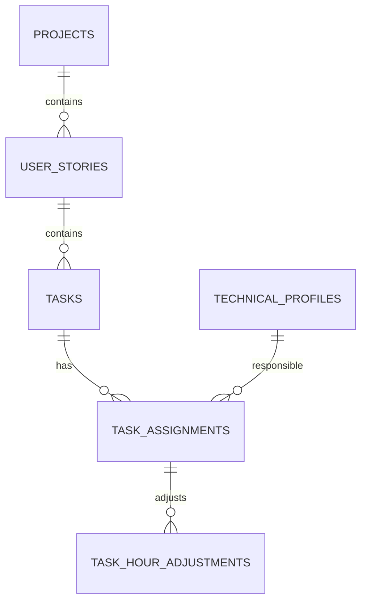

# API de historias y tareas

La API usa Spring MVC, Spring Data JPA, PostgreSQL y Flyway. Los recursos se exponen bajo `/api/v1`; los listados siguen el contrato compartido `POST /search`, con paginación base cero y máximo de 100 elementos. La documentación OpenAPI se genera en `/v3/api-docs` y Swagger UI en `/swagger-ui.html`.

## Modelo e integridad



- Una historia pertenece a un proyecto; el código es único dentro del proyecto.
- Una tarea pertenece a una historia. Su proyecto se obtiene por esa historia, no se almacena de nuevo.
- Las asignaciones tarea-perfil usan la clave primaria compuesta `(task_id, technical_profile_id)`.
- La API usa borrado lógico para proyectos, historias y tareas. No elimina filas relacionadas en cascada.
- No se elimina un proyecto con historias activas ni una historia con tareas activas; ambas operaciones responden `409`.
- Los perfiles responsables deben existir, estar activos y no estar eliminados. Las listas de asignación reemplazan el conjunto actual en una transacción.
- La prioridad de tareas no existe en el esquema actual; las tareas usan `TODO`, `IN_PROGRESS` y `DONE`.

## Endpoints

Todas las rutas salvo `/health` requieren `Authorization: Bearer <token>` y el permiso indicado. Las listas se devuelven como `PaginatedResponse` bajo `userStoryResponse` o `taskResponse`.

| Método y ruta | Operación | Permiso | Respuestas principales |
| --- | --- | --- | --- |
| `POST /api/v1/projects/{projectId}/user-stories` | Crear historia | `backlog:write` | `201`, `400`, `404`, `409` |
| `POST /api/v1/projects/{projectId}/user-stories/search` | Listar historias paginadas del proyecto | `backlog:read` | `200`, `400`, `404` |
| `GET /api/v1/user-stories/{id}` | Consultar historia | `backlog:read` | `200`, `404` |
| `PATCH /api/v1/user-stories/{id}` | Actualizar campos de historia | `backlog:write` | `200`, `400`, `404` |
| `DELETE /api/v1/user-stories/{id}` | Borrado lógico, solo sin tareas activas | `backlog:delete` | `204`, `404`, `409` |
| `POST /api/v1/user-stories/{storyId}/tasks` | Crear tarea | `backlog:write` | `201`, `400`, `404` |
| `POST /api/v1/user-stories/{storyId}/tasks/search` | Listar tareas paginadas de la historia | `backlog:read` | `200`, `400`, `404` |
| `POST /api/v1/projects/{projectId}/tasks/search` | Listar tareas paginadas del proyecto | `backlog:read` | `200`, `400`, `404` |
| `GET /api/v1/tasks/{id}` | Consultar tarea | `backlog:read` | `200`, `404` |
| `PATCH /api/v1/tasks/{id}` | Actualizar campos de tarea | `backlog:write` | `200`, `400`, `404` |
| `DELETE /api/v1/tasks/{id}` | Borrado lógico de tarea | `backlog:delete` | `204`, `404` |
| `GET /api/v1/tasks/{id}/responsibles` | Consultar perfiles asignados | `backlog:read` | `200`, `404` |
| `PUT /api/v1/tasks/{id}/responsibles` | Reemplazar asignaciones | `backlog:write` | `200`, `400`, `404` |
| `GET /health` | Comprobar API y conexión PostgreSQL | Público | `200` si está disponible |

El contrato compartido de paginación acepta `filters` y `pagination`. Por ejemplo:

```json
{
  "filters": [{ "key": "status", "operator": "EQ", "values": ["READY"] }],
  "pagination": {
    "pageNumber": 0,
    "pageSize": 20,
    "orderBy": "position",
    "sortDirection": "ASC"
  }
}
```

Los campos permitidos para filtrar u ordenar se validan por recurso; los no permitidos responden `400`.

## Cuerpos de solicitud

Crear una historia en un proyecto:

```json
{
  "code": "US-101",
  "title": "Consultar estimación",
  "description": "La persona usuaria consulta la estimación del proyecto.",
  "acceptanceCriteria": "Se muestra el total y el desglose.",
  "priority": "HIGH",
  "storyPoints": 5
}
```

`code`, `title` y `description` son obligatorios. `acceptanceCriteria` y `storyPoints` son opcionales; la prioridad predeterminada es `MEDIUM`. El estado inicial es `DRAFT` y la posición se asigna automáticamente.

Crear una tarea y asignar perfiles opcionalmente:

```json
{
  "title": "Implementar consulta",
  "description": "Crear el endpoint de lectura.",
  "estimateHours": 4,
  "status": "TODO",
  "responsibleProfileIds": ["6f3d2fbb-3d35-4e18-8b71-05e48cbe37bd"]
}
```

La tarea requiere título, descripción y horas positivas. `status` predetermina `TODO`. Los responsables pueden omitirse o ser una lista vacía. Para reemplazarlos después:

```json
{
  "responsibleProfileIds": ["6f3d2fbb-3d35-4e18-8b71-05e48cbe37bd"]
}
```

En las rutas `PATCH`, se envían únicamente los campos a cambiar. No se permiten títulos o descripciones en blanco. La historia y su proyecto no se pueden reasignar mediante esta operación.

## Respuestas y errores

Creación devuelve `201` y un DTO del recurso; consulta/actualización devuelve `200`; borrado lógico devuelve `204` sin cuerpo. Los errores conservan el formato estándar de `docs/errors.md`:

```json
{
  "code": 404,
  "message": "Historia de usuario no encontrada",
  "cause": "Not Found",
  "path": "GET http://localhost:8080/api/v1/user-stories/{id}",
  "timestamp": "2026-10-16T12:00:00"
}
```

`400` indica entrada o filtro inválido; `401` falta autenticación o el token no es válido; `403` falta permiso; `404` no existe el recurso o perfil; `409` hay código duplicado o una regla de integridad impide borrar. Una lista con IDs duplicados responde `400`; un perfil inexistente, eliminado o inactivo responde `404` y no guarda cambios parciales.

## Autenticación

El inicio de sesión existente es `POST /api/v1/auth/login` con correo y contraseña; devuelve `token`, `refreshToken`, `tokenType` y permisos. Envíe el token de acceso como `Authorization: Bearer <token>`. El refresh se realiza mediante `POST /api/v1/auth/refresh-token`. Los roles y permisos preexistentes definen el acceso: administrador posee los permisos de backlog, estimador puede leer y escribir, y consultor puede leer.

Ejemplo de creación autenticada:

```bash
curl -X POST "$API_URL/api/v1/projects/$PROJECT_ID/user-stories" \
  -H "Authorization: Bearer $ACCESS_TOKEN" \
  -H "Content-Type: application/json" \
  -d '{"code":"US-101","title":"Consultar estimación","description":"Ver el total estimado"}'
```

## Instalación local

Requiere JDK 25 y PostgreSQL 13 o posterior. Cree una base vacía `in_scope_db`; Flyway aplica las migraciones al iniciar. Defina en `.env` (ignorado por Git) o en el entorno:

```dotenv
SERVER_PORT=8080
SPRING_DATASOURCE_URL=jdbc:postgresql://localhost:5432/in_scope_db
SPRING_DATASOURCE_USERNAME=postgres
SPRING_DATASOURCE_PASSWORD=<contraseña-local>
SPRING_MAIL_USERNAME=<cuenta-smtp>
SPRING_MAIL_PASSWORD=<credencial-smtp>
IN_SCOPE_CORS_ALLOWED_ORIGINS=http://localhost:3000
IN_SCOPE_JWT_SECRET=<secreto-aleatorio-de-al-menos-32-bytes>
IN_SCOPE_JWT_EXPIRATION_MS=86400000
IN_SCOPE_JWT_REFRESH_EXPIRATION_MS=604800000
```

Genere un secreto de desarrollo con `openssl rand -base64 48`; no reutilice secretos locales en producción. Inicie la aplicación con:

```bash
bash ./mvnw spring-boot:run
```

`PORT` tiene prioridad sobre `SERVER_PORT`, lo que permite usar el puerto asignado por Render. Swagger UI queda en `http://localhost:8080/swagger-ui.html`.

## Render

El archivo `render.yaml` declara el servicio Docker, PostgreSQL administrado y el health check. Cree un Blueprint desde este repositorio; antes del primer despliegue configure `IN_SCOPE_CORS_ALLOWED_ORIGINS` con los orígenes exactos autorizados y las credenciales SMTP. Render genera `IN_SCOPE_JWT_SECRET` y enlaza las credenciales de la base de datos. Flyway se ejecuta durante el arranque.

Después del despliegue, compruebe `GET /health`; use la URL asignada por Render como base de API y configure ese origen en el frontend separado. No se ha realizado ni verificado un despliegue desde este repositorio.

## Pruebas y tareas de Jira

Las pruebas unitarias del servicio se ejecutan con:

```bash
bash ./mvnw -Dtest=UserStoryServiceImplTest,TaskServiceImplTest test
```

No se detectó una integración autorizada con Jira. Tareas sugeridas para registrar manualmente:

- Backend: CRUD de historias y reglas de eliminación.
- Backend: CRUD de tareas y consulta por proyecto/historia.
- Backend: asignación transaccional de perfiles técnicos.
- QA: pruebas de autorización, validaciones y persistencia PostgreSQL.
- DevOps: desplegar Blueprint en Render y configurar CORS/SMTP.
- Integración: consumir los contratos documentados desde el repositorio frontend cuando esté disponible.

No se ha comprobado consumo de esta API desde el frontend.